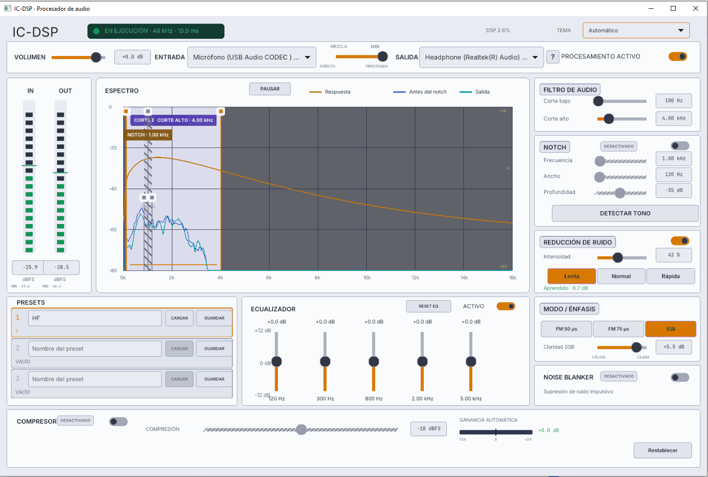

# IC-DSP

Procesador de audio en tiempo real escrito en Go, con interfaz Raylib/SimpleUI.



## Ejecutar

La interfaz puede ejecutarse sin captura de audio:

```powershell
cd audio-processing-core
go run ./cmd/ic-dsp
```

Para generar el ejecutable con dispositivos reales de entrada y salida, ejecute
desde la carpeta principal:

```powershell
.\build-windows.ps1
```

El script reutiliza GCC de
`GO-Zero/build/radiosonde-toolchain/w64devkit`, activa CGO y compila Raylib con
la etiqueta `noaudio`. Esta etiqueta es necesaria porque la aplicación usa
miniaudio mediante `malgo`; evita enlazar también la copia interna de miniaudio
incluida en Raylib.

## Controles del notch

- Arrastrar el indicador cuadrado central del notch: frecuencia.
- Arrastrar cualquiera de los bordes ámbar: ancho.
- Rueda sobre el espectro: ancho.
- `Shift` + rueda: profundidad.
- Doble clic: activar o desactivar.
- El panel derecho y la gráfica permanecen sincronizados.

## Filtro de paso

- Arrastrar la línea cian izquierda: corte bajo.
- Arrastrar la línea cian derecha: corte alto.
- Las zonas sombreadas muestran las frecuencias rechazadas.
- Los límites gráficos y los sliders permanecen sincronizados.
- La curva ámbar superpuesta representa la respuesta combinada del paso de
  banda, notch, ecualizador y énfasis FM.

## Supervisión

- El espectro utiliza suavizado visual y puede pausarse o reanudarse.
- Los medidores IN/OUT retienen durante dos segundos el aviso `CLIP`; se puede
  borrar inmediatamente haciendo clic sobre el medidor correspondiente.
- Cada medidor muestra RMS y una línea de retención de pico con caída gradual.
- El botón `↻` vuelve a enumerar los dispositivos y conserva la selección
  anterior cuando continúa disponible.
- Ante un error del flujo de audio, la aplicación intenta reconectarse cada
  cinco segundos. Las selecciones de entrada y salida se recuerdan entre
  ejecuciones.
- La cabecera muestra la carga de CPU consumida por el procesamiento DSP.

## Tema visual

El selector de la cabecera ofrece `Automático`, `Claro` y `Oscuro`. El modo
automático lee el tema de aplicaciones y el color de énfasis configurados en
Windows. La preferencia queda guardada entre ejecuciones.

El botón `RESET EQ` restablece únicamente las cinco bandas del ecualizador a
0 dB, sin modificar ningún otro procesamiento.

## Noise blanker

El panel `NOISE BLANKER` activa la supresión de ruido impulsivo antes del resto
de la cadena. El detector compara cada muestra con una predicción local y
reconstruye únicamente los impulsos anómalos de muy corta duración, como
chasquidos eléctricos o descargas. Su estado se guarda en cada preset.

## FM y SSB

El panel `MODO / ÉNFASIS` permite seleccionar desénfasis FM de 50 µs, 75 µs o
el modo SSB. En SSB se habilita un control de claridad de -6 a +9 dB que inclina
suavemente la banda de voz entre un sonido más cálido y una mayor inteligibilidad.
Los botones del modo seleccionado y de la velocidad del reductor de ruido se
resaltan en violeta. Todos estos valores forman parte de cada preset.

## Volumen de salida

El control superior `VOLUMEN` aplica una ganancia final de -60 a +12 dB antes
del limitador de seguridad. El valor forma parte del preset guardado.

## Compresor

El compresor automático utiliza un único control de compresión, de -30 a -6 dBFS. Si
la señal está por debajo del objetivo aumenta gradualmente la ganancia; si lo
supera, la reduce con rapidez. La amplificación queda congelada durante los
silencios para no elevar innecesariamente el ruido de fondo. Se procesa antes
del volumen de salida y del limitador final. Un medidor bipolar muestra en
tiempo real si está amplificando o atenuando la señal.

La aplicación ofrece tres slots de preset con nombres editables. Cada slot
permite guardar o cargar una configuración completa; el activo queda resaltado
y muestra `MODIFICADO` cuando los controles dejan de coincidir con lo guardado.
La sobrescritura requiere un segundo clic de confirmación durante tres segundos.
Los datos se guardan en `IC-DSP/presets.json`. El antiguo `preset.json` se
migra automáticamente al primer slot.
